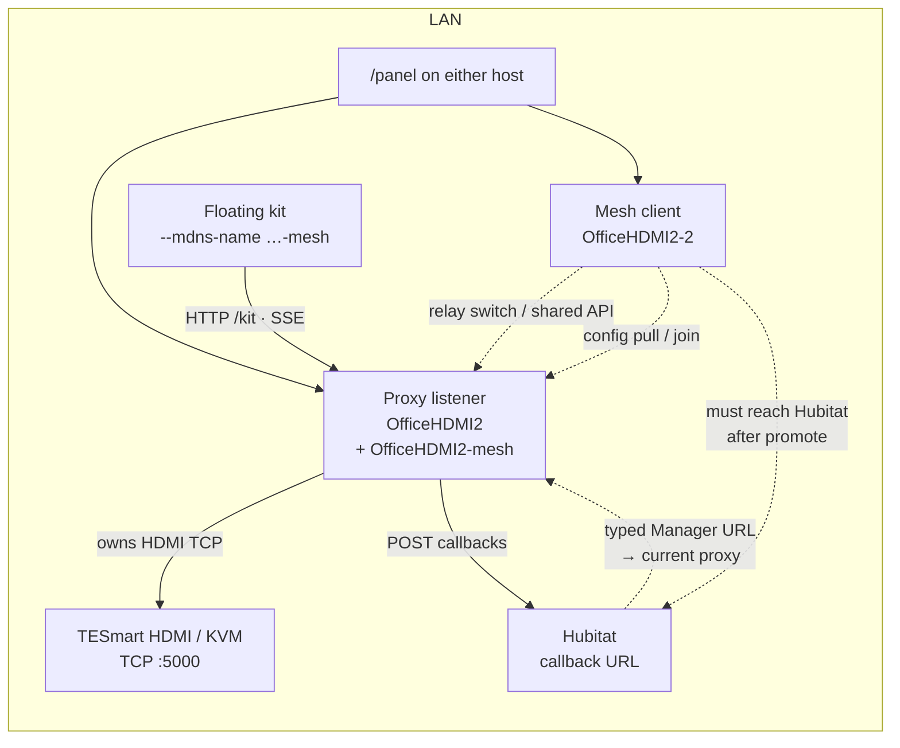
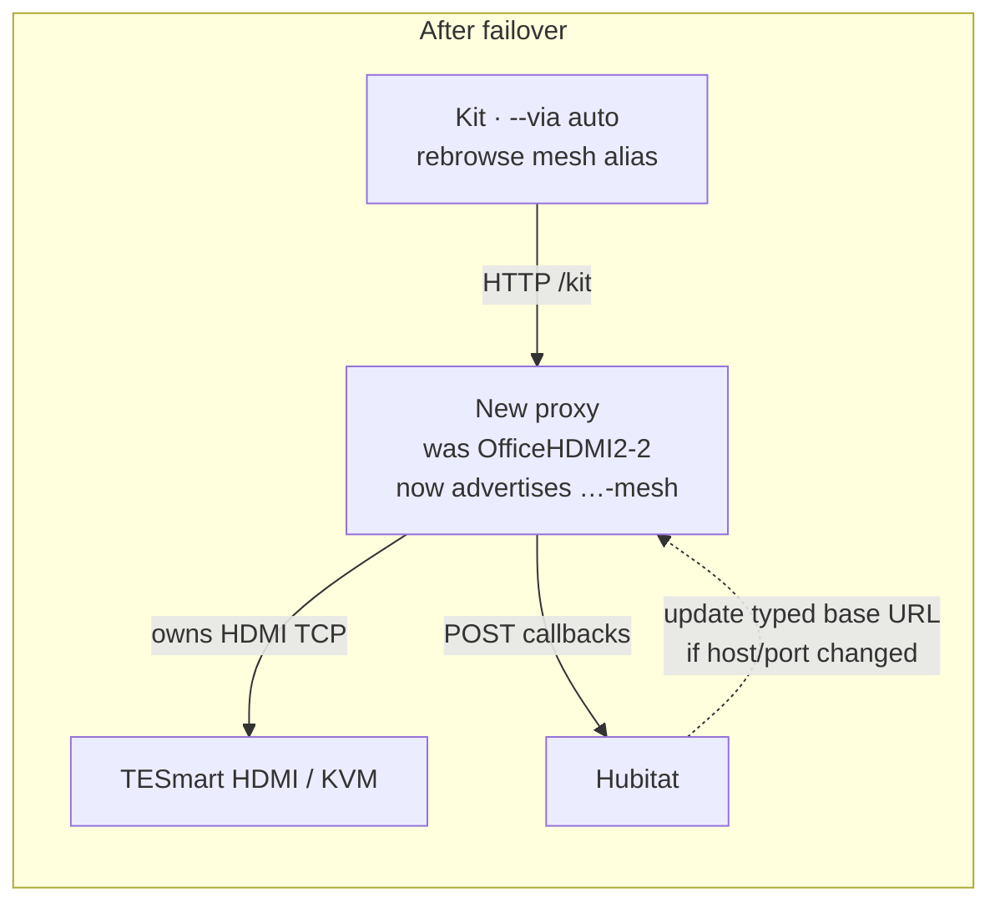

# Mesh support (experimental)

**Status: experimental** — TCP switches only; **off by default**. Expect sharp edges; Hubitat and other typed URLs still need a manual update when the proxy host changes.

## What it is for

Mesh lets **more than one** `tesmartctl` listener aim at the **same** HDMI switch over LAN, without opening two TCP sessions to the box.

Typical reasons to turn it on:

1. **Host move without a blackout** — start a second listener on the new machine, let it join, stop the old one; a survivor becomes the switch owner.
2. **Failover** — another mesh peer can take over the TCP session when the proxy goes away on purpose (**Ctrl-C** / stop) **or** abruptly (listener crash, `kill -9`, host reboot, power or network loss). Graceful leave pushes peers to elect immediately; hard loss is caught by the mesh health watcher within a few seconds.
3. **Spare front door** — every peer still serves `/kit` and `/panel` under its own name; switch commands from a mesh client are relayed to whoever currently owns the session.

Without mesh, two listeners on one switch fight over the TESmart TCP port. Mesh elects a single **proxy** (switch owner). Other mesh peers are **clients**: they share config from the proxy and relay switch work through it.

Clients that should **follow failover** (floating kit, `--via auto`) should resolve the shared **mesh mDNS alias** (for example `OfficeHDMI2-mesh`), not a single host’s instance name. Sticky clients keep using the instance name.

Hubitat push callbacks fire from the **proxy only**, but **any** mesh peer can become proxy after failover. So every host in the mesh must be able to **reach Hubitat** (the callback URL on the hub). Likewise, Hubitat must be able to reach whichever host is currently proxy if you use a typed Manager base URL — update that URL after a host move until discovery for Hubitat exists.

## How it connects

Steady state: one TCP session to the switch, clients relay through the proxy, kit follows the mesh alias, Hubitat callbacks leave from the proxy (every mesh host must still be able to reach Hubitat).



After the proxy is gone (Ctrl-C **or** crash / host down), a survivor opens TCP, advertises the same mesh alias, and Hubitat POSTs move with it:



## Quick start

```bash
# On each host that should participate (same TESMART_HOST / TESMART_PORT):
tesmartctl listen --http 0.0.0.0:7272 --panel --mdns-name OfficeHDMI2 --mesh
# second host:
tesmartctl listen --http 0.0.0.0:7273 --panel --mdns-name OfficeHDMI2-2 --mesh

tesmartctl mesh status
# Kit that follows whoever is proxy:
tesmartctl --via auto kit --mdns-name OfficeHDMI2-mesh
```

Also: `TESMART_HTTP_MESH=1`, `tesmartctl quickstart --mesh`, and an install prompt that can persist the flag.

Different mDNS instance names are fine. Peers group by **switch identity** (`tcp:host:port`), not by mDNS name.

---

## Reference

### Mesh failover mDNS name

Each peer keeps its **instance** DNS-SD name (`OfficeHDMI1`, `OfficeHDMI2`, …). The elected **proxy** also advertises a second, shared name — the **mesh alias** — so clients that should follow failover can pin that name without changing resolve logic.

| Client intent | Use |
|---|---|
| Sticky to one host | Instance name (`--mdns-name OfficeHDMI1`) |
| Follow whoever is proxy | Mesh alias (`--mdns-name OfficeHDMI1-mesh`) |

Default alias: `{instance}-mesh` of the first proxy (persisted as `TESMART_HTTP_MESH_MDNS_NAME`). Override with `--mesh-mdns-name` / the env key. Joining peers learn the alias from `/mesh/join` and, on promotion, advertise **that same** alias (not their own `{name}-mesh`). Mesh clients do not advertise the alias. `tesmartctl discover` groups instance peers under the mesh alias when present.

Listeners publish both `mdns_name` (instance) and `mesh_mdns_name` (failover alias) on `/version`, `/status`, `/api/state`, and SSE `hello`. Kit/panel identity checks accept **either** name.

**Kit failover:** launch with `--via auto --mdns-name <mesh-alias>` (or the same saved client name). When the proxy stops, the kit’s native watcher browses and reloads `/kit` on the new endpoint.

**`/api/state` stays in-memory** on the hot path (cached active input; no HDMI I/O), so kit/panel do not hang while promote opens TCP.

**Rejoin:** election prefers an existing `role=proxy` peer so a restarted listener joins instead of stealing.

## Locked decisions

| Topic | Decision |
|---|---|
| Default | Mesh off unless explicitly enabled |
| Maturity | **Experimental** in 0.0.7.19 |
| Kit UI | No dedicated mesh chrome; status on `/panel` |
| Serial / RS232 | Out of scope (TCP only for now) |
| Hubitat / sticky URLs | Every mesh host must reach the Hubitat callback URL; operators move Manager / typed base URLs **manually** when the proxy host changes |
| Clock skew | Election uses each instance’s reported `started_at` (epoch ms). Tie-break: mDNS instance name, then base URL |

## Roles

| Role | Switch TCP | HTTP | Behavior |
|---|---|---|---|
| **Proxy** | Owns the only session | Normal panel / API / kit HTTP | Accepts joins; executes switch ops; owns canonical env (names, banners, enablement, cycle, callbacks, `last_sent`); outbound Hubitat POSTs |
| **Mesh client** | No switch session | Own mDNS + HTTP | Relays switch/shared routes to the proxy; mirrors env; local SSE for kit/panel |
| **Non-mesh** (default) | Own session | Unchanged | Mesh peers warn if a standalone listener targets the same switch |

## Startup (`--mesh` / quickstart with mesh on)

1. Resolve switch id from `TESMART_HOST` + `TESMART_PORT` (serial paths refuse mesh).
2. Browse mDNS (`_wbevan-tesmart._tcp`).
3. Keep peers with `mesh=1` and the same `switch` id.
4. If a proxy exists: `POST /mesh/join`, pull config, **do not** open TCP, serve as relay.
5. If join fails: re-browse and re-elect.
6. If none older (or last standing): open the switch, become proxy, advertise mesh TXT.
7. Background: watch proxy health; on loss, re-elect (may open TCP and become proxy).

## Relay vs local

**Relay to proxy:** input / next / previous / peek / cycle start·stop; buzzer / LED / autodetect / network write; names; enable/disable; peek-default / peek-follow; banner; callbacks (canonical list on proxy); switch fields of status / `/api/state`.

**Local on every node:** static `/panel`, `/kit`, `/static`; own mDNS name; `/mesh` self view; kit prefs file (`kit.json`) — look/feel is not overwritten from the proxy. Outbound Hubitat callbacks (including peek-follow) fire from the **proxy only**; after promote, that is whichever peer won, so Hubitat must stay reachable from all mesh instances.

## APIs

### mDNS TXT additions

| Property | Meaning |
|---|---|
| `mesh` | `1` when mesh enabled |
| `switch` | `tcp:host:port` |
| `started` | Unix epoch (ms) at process start |
| `role` | `proxy` \| `client` |
| `mesh_name` | Shared failover DNS-SD name |
| `kind` | `mesh` on the failover alias advertisement only |
| `link` | `up` when this process owns HDMI TCP; `down` for clients or a proxy still opening |

### HTTP

| Method | Path | Purpose |
|---|---|---|
| `GET` | `/mesh` | Self: role, switch_id, started_at, proxy, peers[], generation, link |
| `GET` | `/mesh/peers` | Peer list |
| `POST` | `/mesh/join` | Client → proxy announce |
| `POST` | `/mesh/leave` | Graceful leave / resign |
| `POST` | `/mesh/proxy-leaving` | Resigning proxy → clients elect now |
| `GET` | `/mesh/config` | Portable dump wrapper |

Feature tag `"mesh"` on `/compat`. `/version`, `/status`, and `/api/state` include a `mesh` object.

## Panel

- **Mesh** card: role, switch id, proxy URL, peer table, conflict warnings.
- **Connect info** modal: mesh role, proxy, peer count.
- API explorer lists `/mesh*`.

## Failover and moves

**Graceful leave** (Ctrl-C / clean process exit): the proxy pushes `POST /mesh/proxy-leaving` to known clients so they elect immediately.

**Abrupt failure** (crashed or killed `tesmartctl`, whole machine down, or the proxy host unreachable): peers cannot get a resign push. The mesh watcher (~every 3s `GET /mesh` / discovery) notices the proxy is gone and runs the same election. Failover is slower than a clean resign by roughly that interval, but it does not require a polite shutdown.

Promote rebinds the callback watcher, peeker, and cycler onto the new TCP session and retries open if the old proxy still holds the port briefly.

**Planned move:** start B with mesh → joins A → stop A → B (or another survivor) becomes proxy. Update Hubitat / typed URLs if the host or port changed.

## CLI

```bash
tesmartctl listen --http … --mesh
tesmartctl quickstart --mesh
tesmartctl mesh status
tesmartctl --via auto mesh status
```
