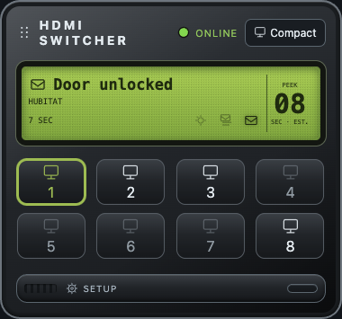
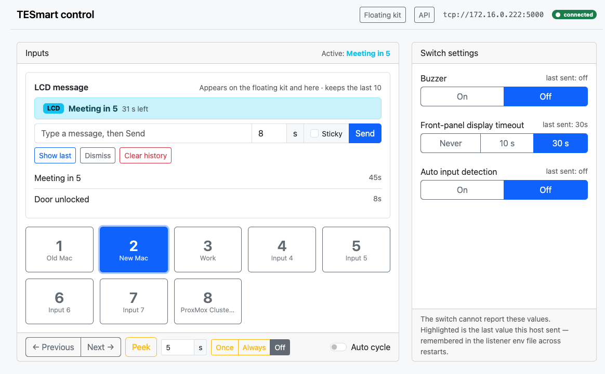
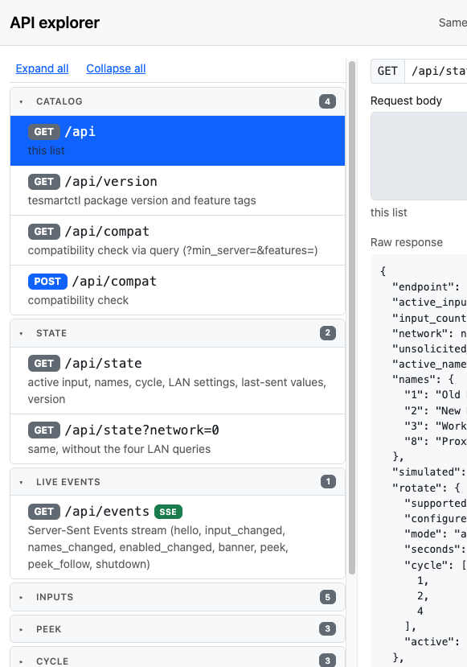

# Control panel and floating kit

Start the server with `tesmartctl install`, then `tesmartctl quickstart`. Install turns the browser UI on by default and saves that choice. `quickstart` serves the pages.

`/kit` is the floating UI application kit. `/panel` is the browser-only control panel. The pages are part of the HTTP listener (`tesmartctl listen --http PORT --panel`). Without `--panel`, `/panel`, `/kit`, `/static/...`, and `/api/...` answer `404` with a short explanation.

```bash
tesmartctl install
tesmartctl quickstart
# the same start, written out:
tesmartctl listen --http 8080 --panel
# floating UI application kit:  http://127.0.0.1:8080/kit
# browser-only control panel:   http://127.0.0.1:8080/panel
```

`--panel` on its own is an error: the pages are part of the HTTP listener. `--bind` and `--http` are still mutually exclusive. A bare port binds `127.0.0.1`. There is no authentication, same as the rest of the listener.

### Floating UI application kit (`/kit`)

`/kit` is the floating UI application kit, the primary day-to-day surface: HDMI-style deck, Setup door for peek/cycle, Compact mode, and a frameless desktop window via `tesmartctl kit`. It talks to the same `/api` routes as `/panel`, and both subscribe to `GET /api/events` (Server-Sent Events) for live input, name, and banner updates. A slower `/api/state` poll remains as a fallback; while the HDMI switch is offline the poll runs about every 2 seconds so the UI reconnects quickly. Ctrl-C on the listener sends `shutdown` first: the kit headline says **CONTROLLER SHUTDOWN** and the panel link says **shutdown**. A crash or a lost connection shows **CONTROLLER OFFLINE** and **unreachable**. `tesmartctl --via auto kit` keeps browsing after the first connection. While the listener is stopped it loads the kit from the new host or port when the same mDNS name moves, without restarting the window. The same host and port still recovers through that poll when it advertises the mDNS name this client is using. A different name on that address fails the reconnect: the kit stays offline and does not drive that process. A typed `--via http://…` URL stays on that address.



```bash
pip install 'tesmartctl[kit]'          # frameless pywebview (recommended)
tesmartctl listen --http 0.0.0.0:8080 --panel
tesmartctl kit --listen 8080          # frameless on this machine → http://127.0.0.1:8080/kit?app=1
```

**Pop out** on the kit page (or **Floating kit** on `/panel`) calls `POST /api/kit-window` and opens the frameless window on the **listener host**. Preferred backend is `pywebview` — no OS title bar, and the window is transparent so only the rounded device shows (macOS draws the shadow around its shape). On Windows the same frameless window is clipped to the deck's corner radius, so the square corners outside that curve are not part of the window. The kit window itself is cross-platform. On macOS only, Dock branding uses a small optional `TESmart Kit.app` helper (`tesmart/kit_macos.py`, under `~/.config/tesmartctl/`) because a bare Python process cannot replace the document icon — Linux/Windows keep the normal `python -m tesmart.kit_window` launch. The macOS app's main program is a small signed executable inside the bundle. It loads the installed Python and stays the process, so macOS attributes the LAN connection to TESmart Kit. Until TESmart Kit is allowed under Privacy & Security → Local Network, the kit reports No route to host for an address the browser opens. The same helper inserts an **Inputs** item into the menu bar in the same step that installs that bar, before the kit contacts the listener. Until the controller answers, the rows under **Inputs** are shown and disabled. After that they enable: names and the active checkmark update from the listener. **Peek Off**, **Peek Once**, and **Peek Always** sit under that list and follow the same enabled state. Changing the peek duration sends the current mode again with the new seconds (`POST /api/peek-follow`), so other clients update the number as well as the mode. The kit and panel update the peek control immediately from that change. Choosing an input sends `POST /api/input`. The menu is not drawn on the kit window. On the deck itself, hovering an input key shows that input’s name, the same way the header icons show their labels.

#### Static asset cache

`/static/...` responses are cached by the kit window (and browsers) for a week (`Cache-Control: public, max-age=604800, immutable`). Every static URL is stamped with `?v=<tesmartctl version>` from the HTML shell, so a server upgrade changes the URL and forces a re-download. `/kit` and `/panel` HTML stay `no-cache` so the new token is always seen. `tesmartctl kit --fresh` (or `?fresh=1`) clears the native HTTP cache and uses a one-shot token so assets reload even when the package version is unchanged. API routes remain `no-store`. Fallback is Chromium/Chrome/Edge `--app` (no address bar; macOS still keeps a title bar). Drag the kit header (grip) to move. The header **power** control closes the frameless window (it does not power the switch). **Always on top** lives under Setup. A first launch opens in **Compact**; after that the kit reopens the way you left it (see *Remembered kit settings* below). The monitor button shows the current size; click it to cycle **Compact → Mini → Full** (Mini is LCD with Up/Down input buttons beside it). Changing size closes Setup. Resize floors follow the view ladder: Full cannot go below Compact’s snap size, Compact cannot go below Mini, and Mini keeps its own snap as the floor. Switching view moves the limit with it. Drag any edge bigger and the device's border grows to meet it — the rounded panel always touches all four sides of the window, so there is never a transparent gap between the device and the edge you dragged. You can widen the window freely: the deck fills the width, input keys keep a fixed size, and when there is room they sit on a single row. On multi-monitor setups (including a portrait display) the window stays clamped to the screen it is on when Compact/Mini/Expand snaps the size.

#### Remembered kit settings

The kit remembers, per machine:

| Setting | Restored on next launch |
|---|---|
| Window position | Top-left corner, if that spot is still on a connected display |
| Always on top | On or off |
| View size | Compact, Mini, or Full |
| Peek-follow | **Always** is re-armed if the listener has it off; **Once** is one-shot and not remembered |
| Body colour | Charcoal black (default) or metallic silver |
| LCD colour | Green (default), blue, red, or dark with orange phosphor |
| LCD brightness | **40%–100%** (default **100%**); Setup slider under LCD colour |
| LCD auto-dim | Off by default. When on, after **1–120** idle seconds (default **30**) the glass fades to **40%** without changing Bright; input, banner, peek, and cycle activity restore Bright and restart the timer. A half-sun icon on the LCD shows when auto-dim is enabled |
| Highlight colour | Optional custom `#RRGGBB`; **Default** in Setup restores the LCD match |
| LCD glass | **Matrix** (default mesh), **Phosphor** (mesh + colour bleed in glyphs), or **Off** |
| Hide disabled inputs | When on, the layout shows enabled inputs only, in number order |
| Display names | When on, each button shows its local name. An unnamed input keeps its number |

The active input key keeps the metal face artwork and shows an inset ring plus numeral and monitor glyph in the highlight colour (LCD match by default, or a custom colour from Setup). Setup toggles and theme swatches use that same colour. On the silver body, chrome and input keys are raised brushed metal with dark ink so they stay readable on the fascia. LCD **Glass** in Setup chooses the look: **Matrix** is a visible pixel grill over solid type; **Phosphor** adds a soft LCD-colour glow on the text; **Off** is plain glass. Glyphs are never punched into dots (that went unreadable when the window was large). Opening or closing the Setup door grows or shrinks height for the bay; if you have stretched the window wider than Compact/Full, that width is kept (it does not snap back to the design width).

The peek duration is already stored by the listener in its env file, so it is shared by every client.

The frameless window keeps these in `~/.config/tesmartctl/kit.json` (pywebview clears browser storage between launches). Browser tabs, popups, and Chromium `--app` windows use the browser’s `localStorage`.

On open, the frameless kit (`tesmartctl kit` / pywebview) probes the listener first. If `/kit` answers, that page opens. If not, a **packaged boot deck** (`tesmart/static/kit/boot.html`, loaded as `file://` with the same CSS/SVG as the live kit) paints immediately so the window is never blank Chromium. The LCD scrolls ephemeral status while it retries; those lines are not banners and are not stored in `kit.json`. When the listener responds, the window navigates to live `/kit`. Browser cache alone is unreliable here (private webview + `--fresh`), so the shell ships with the package instead. Chromium `--app` fallback still needs a reachable URL.

Once the live page is up, short in-page boot steps (preferences, state, events, ready) can still scroll on the LCD; also display-only.

If the kit opens somewhere odd or in a bad state, start it with saved settings ignored:

```bash
tesmartctl kit --fresh                                 # or: tesmartctl kit 'http://…/kit?app=1' --fresh
```

`--fresh` opens with defaults (Compact, under the pointer, not on top, no peek re-arm). Anything you change in that session is saved over the old settings. In a browser, add `fresh=1` to the URL (`/kit?fresh=1`) for the same effect.

If the kit opens but you cannot see it on any monitor (saved position on a disconnected display), force a clean open:

```bash
tesmartctl kit --reset
# or with mDNS:
tesmartctl --via auto kit --reset
```

`--reset` deletes `~/.config/tesmartctl/kit.json` and then launches like `--fresh`. You can also delete that file by hand.

#### Launch from another machine

The kit UI talks to the **listener**, not the HDMI switch. Any computer that can reach the listener can run the kit.

1. On the server (where the switch is controlled), bind every interface and enable the panel:

```bash
tesmartctl listen --http 0.0.0.0:8080 --panel
```

2. On another machine on the same network:

```bash
# browser tab
open 'http://192.168.1.20:8080/kit'

# or frameless window on *this* machine, pointed at the remote listener
# (quote the URL so the shell keeps ?app=1)
pip install 'tesmartctl[kit]'
tesmartctl kit 'http://192.168.1.20:8080/kit?app=1'
```

Replace `192.168.1.20:8080` with the listener’s address. There is no authentication — only do this on a network you trust.

**Note:** clicking **Pop out** in a remote browser still opens the window on the listener host. To get a frameless window on your own desk while the listener runs elsewhere, use `tesmartctl kit 'http://…/kit?app=1'` on the local machine.

### Full Bootstrap panel (`/panel`)

`/panel` remains available as the fuller Bootstrap UI (network wizard, API explorer, write-only settings). Outcomes appear as toasts. Changing the switch's address opens a three-step dialog; the browser's own alert and confirm dialogs are not used.



**Connect info** in the top bar opens a dialog with this listener's address, the HDMI switch endpoint, the mDNS name when the process is advertising, and sample `curl` / `tesmartctl` commands. **Copy samples** puts that block on the clipboard. The same links are printed by `tesmartctl install` ([Docs/install.md](install.md)).

**API** in the top bar opens `/panel/api` in a separate browser window so you can keep using the control panel underneath. That page lists every `/api` route in groups (`GET /api` returns the same list as `catalog`, with a `group` on each entry). Picking a route fills the path and a sample body; **Send** shows the status code and the raw body. **Live events** → `GET /api/events` is marked SSE: **Listen** opens the stream and lists frames newest first (icon + short preview; expand a row for the full JSON). Rows that carry a `source` show **Switch** (`unsolicited` — front panel, IR, auto-detect, or another client) or **Listener** (`command` — this process changed it). **Stop** closes the stream. `POST /api/network` is listed but not sent from there: address changes stay on **Change address**.



## What the page controls

| Section | What it does | Where it is stored |
| --- | --- | --- |
| Inputs | One button per input. The face shows the number; hover the button to see the input name. The active input is highlighted. | The switch |
| LCD message | Dedicated **LCD message** block on `/panel`: type a line and **Send** (timed seconds or **Sticky**). **Show last**, **Dismiss**, and **Clear history** call the listener so the floating kit updates too. Recent messages (up to 10; the 11th drops the oldest) appear under the compose row — click one to send it again. Same from the CLI: `tesmartctl banner "…"` (optional `--from`). History is persisted in the env file. **Dismiss** (panel / Hubitat / CLI) sets `showing: false` on the listener — kits hide that broadcast; the text stays in history. The kit message icon can still show/hide locally while the server still says showing; a server dismiss or reshow overrides that. On the kit, message history floats over the deck (translucent scrim; no window resize); picks stay local to that kit. After a UI upgrade, open `/panel?fresh=1` or `/kit?fresh=1` once so the browser drops a stale cached JS. | This listener (`POST /api/banner` / `tesmartctl banner`, persisted). Panel Show / Dismiss / Clear sync via the API. |
| Previous / Next | Step through the saved cycle | The switch, using the local cycle list |
| Peek | With Peek on, an input button shows that input for the number of seconds beside it and then returns. The header shows a countdown and **Back now**. Changing the seconds saves the default. | This listener times it; the duration is in the env file |
| Auto cycle | Starts or stops the listener-owned automatic cycle (same runner as kit **Start cycle** and `tesmartctl cycle run --via`). The checkbox follows `rotate.active` from `/api/state` / SSE `cycle`. | This listener |
| Buzzer, display timeout, auto input detection | The same three write-only settings as the vendor General page | Sent to the switch and remembered in the listener env file (`last_sent`). Other clients can read them from `/status` or `/api/state`. |
| Input names | Local labels, saved when you leave the field. Empty clears a name. Each row has an **Enabled** checkbox. Unchecked inputs are ignored for selection, peek, and next/previous. At least one input must stay enabled. Inputs are enabled unless the box is cleared, `GET /disable/N` says otherwise, or `tesmartctl disable` does. `tesmartctl --via auto disable 4` writes the listener. A command without `--via` writes this computer. | The listener env file |
| Cycle | Which inputs Previous, Next, and Auto cycle walk, plus manual or automatic and the interval. Saved on every change. | The env file |
| Network | Shows the address stored in the switch. Query reads it again. Apply writes IP, port, gateway, or mask after two separate acknowledgements, then reads the values back. | The switch. Used only after a power cycle. |

The switch still cannot say which HDMI inputs have a signal. The cycle is the list you choose. Leaving every box clear means all inputs.

Names, cycle, and the peek duration have no Save button. They involve no switch traffic, so each change is written to the env file as it happens and a brief "Saved" appears in the card footer. Settings that *do* reach the switch (inputs, buzzer, display timeout, auto-detect, network) are sent only when you press their control.

Peek is not a cycle: one flip there, one flip back. Clicking another input while a peek is running moves the peek to that input and restarts the countdown; the return point stays the original input. If the input is changed by anything else during the peek (front panel, remote, another client), the peek does not snap back over that choice. The auto cycle pauses while a peek is running.

**Peek** beside the duration is this page only: while it is on, the input buttons on this page peek. **Once**, **Always**, and **Off** are the listener. **Once** makes the next plain input change from any client (this page, `/input/3`, another site's button) peek, then later changes stick. **Always** keeps doing that until **Off**. The armed mode is remembered in this listener process and is not written to the env file. The page highlights the mode that is armed. On the floating kit, click the LCD **PEEK** label (countdown column) to cycle **Off → Once → Always**; Setup still has the three separate buttons.

## Changing the address

This is the one action on the page that can take the switch out of reach, so it is deliberately slow:

1. **Change address…** opens the form under a standing warning.
2. **Apply…** opens the dialog at *Warning 1 of 2*: the values about to be written, the fact that a wrong value makes the switch unreachable with no factory reset and RS232 as the only recovery, and a checkbox that must be ticked before **Continue** is enabled.
3. *Warning 2 of 2* states that the change is made at the user's own risk, that the software sends the values exactly as entered and cannot validate, undo, or recover them, and that the software and its authors accept no liability for any loss, damage, downtime, or cost. A second checkbox must be ticked before **Write to switch** is enabled.
4. The listener writes the values and then **reads all four back from the switch**. The final step shows a table of requested versus reported values with `stored` or `mismatch` per row. Green means the switch holds the new value and will use it after the next power cycle. Red means it does not; nothing changes until a power cycle, so a mismatch can be corrected or left alone.

The API enforces the same two acknowledgements: `POST /api/network` is rejected unless the body has both `"confirm": true` and `"accept_risk": true`. The wording the dialog uses is available from `GET /api/network/notice` so other clients can show it.

## API

The page talks to JSON routes under `/api`. `GET /api` lists them. Errors are `{"error": "..."}`. The interactive explorer lives at `/panel/api` (opened from the **API** button as a separate window).

| Method and path | Body | Result |
| --- | --- | --- |
| `GET /api/state` | | Active input, names, which inputs are enabled, cycle (`rotate.active` while cycling), LAN settings, `last_sent`, and `version` |
| `GET /api/version` | | Package version and feature tags |
| `GET` / `POST /api/compat` | `{"min_server":"0.0.7.9","features":["callbacks"]}` | Whether this server meets the client’s requirements |
| `GET /api/state?network=0` | | Same, without the four LAN queries. First load, and a fallback poll (~30s online with SSE; ~2s while the switch is unreachable). |
| `GET /api/events` | | Server-Sent Events stream (`hello`, `input_changed`, `names_changed`, `enabled_changed`, `banner`, `peek`, `peek_follow`, `cycle`, `shutdown`, `online`). Kit and panel subscribe here for live updates. Same payloads as registered callbacks; `banner` includes `banner_history`. `peek` mirrors `/api/state` → `peek.active` for remote peeks. `cycle` mirrors `rotate.active` for the listener-owned automatic cycle. `online` is also POSTed to callback URLs when the listener starts. |
| `POST /api/input` | `{"input": 3}` or `{"input": "Office"}` | `active_input` after the switch reports it |
| `POST /api/next`, `POST /api/previous` | | Next or previous input in the saved cycle |
| `POST /api/peek` | `{"input": 3, "seconds": 5}` | Switches now and returns at once. Publishes SSE `peek` immediately. `/api/state` carries `peek.active` with `previous`, `peeked`, `seconds`, `remaining` until the listener has returned. |
| `POST /api/peek` | `{"cancel": true}` | Return to the previous input now |
| `POST /api/peek-default` | `{"seconds": 8}` | Save the default peek duration |
| `POST /api/peek-follow` | `{"mode": "once"}` | `once`, `always`, or `off`. Optional `"seconds"` overrides the duration for changes taken while this mode is armed |
| `POST /api/buzzer` | `{"on": false}` | Sent. The switch does not confirm it. |
| `POST /api/led` | `{"timeout": "never"}`, `"10"`, or `"30"` | Sent. The switch does not confirm it. |
| `POST /api/autodetect` | `{"on": true}` | Sent. The switch does not confirm it. |
| `GET /api/network` | | IP, port, gateway, and mask stored in the switch |
| `GET /api/network/notice` | | Risk and liability wording as `risks`, `liability`, `after_write` |
| `POST /api/network` | `{"ip": "192.168.1.50", "confirm": true, "accept_risk": true}` | Writes, reads back, returns `requested`, `acknowledged`, `stored`, `verified`, `all_verified` |
| `POST /api/names` | `{"names": {"1": "Office", "2": ""}}` | Empty string removes that name |
| `POST /api/enabled` | `{"input": 4, "enabled": false}` | Enable or disable an input. The same action is `GET /enable/4` and `GET /disable/4` on any HTTP listener. Rejected when it would leave zero inputs enabled |
| `GET /api/callbacks` | | Registered callbacks (`url`, optional `name`, optional `last`) and POST `timeout` |
| `POST /api/callbacks` | `{"url": "http://…", "name": "Hubitat"}` | Register (same URL twice updates the name); name changes also fire `names_changed` callbacks |
| `POST /api/callbacks` | `{"timeout": 10}` | Set how long each callback POST may wait (default 10; API only, not a panel control) |
| `POST /api/callbacks/timeout` | `{"timeout": 10}` | Same as timeout-only POST above |
| `GET` / `POST /api/callbacks/health` | | Probe each client with a `health_check` event; returns `healthy` / `unhealthy` / `results` |
| `DELETE /api/callbacks` | `{"url": "…"}` or `{"name": "…"}` | Unregister |
| `POST /api/callbacks/remove` | `{"url": "…"}` or `{"name": "…"}` | Same as DELETE (for clients that cannot send DELETE) |
| `GET /api/banner` | | `banner` envelope (or null) plus `banner_history` (up to 10, newest first; each has `at` / `at_iso` / `from`) |
| `POST /api/banner` | `{"text": "Door unlocked", "seconds": 8}` | Timed message in the name slot; max 160 chars, 1–60 s (default 8). Kept as last message after it hides. Optional `"from"` replaces the kit status-line label (default `MESSAGE`). |
| `POST /api/banner` | `{"text": "Door unlocked", "sticky": true, "from": "Hubitat"}` | Sticky message until dismissed (kit: press active input again, or message icon / Dismiss) |
| `POST /api/banner` | `{"show": true}` | Put the last message back on the LCD for kit / panel / SSE clients |
| `POST /api/banner` | `{"dismiss": true}` | Hide the current message (kept in history) |
| `POST /api/banner` | `{"clear": true}` | Erase the last message and history |
| `POST /api/cycle` | `{"inputs": [1, 3, 5], "mode": "automatic", "seconds": 15}` | Save list/mode/interval. An empty `inputs` list means every input. Mode must be `automatic` before start. |
| `POST /api/cycle/start` | `{}` | Start the listener-owned cycle; publishes SSE `cycle` with list + current input. |
| `POST /api/cycle/stop` | `{}` | Stop the cycle; SSE `cycle` with `active: null`. |
| `POST /api/kit-window` | `{"prefer": "auto"}` optional `width`/`height`/`url` | Opens `/kit` without browser chrome on the listener host (`chromium-app` or `webview`) |

`POST /api/network` may include any of `ip`, `port`, `gateway`, and `mask`. At least one is required, and both `confirm` and `accept_risk` must be true. `stored` is the full set of four values the switch reports after the write; `verified` compares each requested key against it. `all_verified` is the only result that should be treated as "stored, safe to power-cycle".

The plain listener route `/peek/N` blocks until the switch is back and returns the full result. `/api/peek` is the non-blocking form the page uses so it can show the countdown. Both share one timer per listener; starting a second peek retargets the running one.

These routes exist only so the page can drive the device. The plain listener URLs (`/input`, `/status`, `/rotate`, and the rest in [`listener.md`](listener.md)) are unchanged and still do not mute the buzzer or move the switch's address.

To put input buttons on a page you already have, or to place this panel in an iframe on that page, see [`embed.md`](embed.md).

## Files

| Path | Responsibility |
| --- | --- |
| `tesmart/panel.py` | `/panel`, `/kit`, `/static`, and `/api` |
| `tesmart/kit_window.py` | Chrome-less kit launcher (Chromium `--app` / pywebview) |
| `tesmart/static/panel.html` | Page structure |
| `tesmart/static/panel.css` | Layout the Bootstrap stylesheet does not cover |
| `tesmart/static/panel.js` | `Api`, `Toaster`, `NetworkWizard`, and `Panel` |
| `tesmart/static/kit/` | Floating HDMI UI kit (`index.html`, `kit.js`, `float.css`, assets) |
| `tesmart/notices.py` | The risk and liability wording, shared by the CLI and the API |
