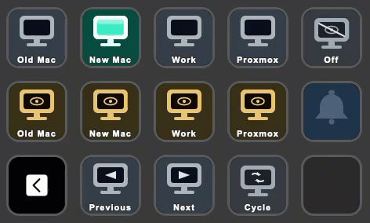

# Elgato Stream Deck

A native Stream Deck plugin is coming soon. The public outline and animated preview are on the project site: [Elgato Stream Deck](https://wbevan.github.io/TESmartController/streamdeck.html).

The preview uses the input names stored on the listener. The live input stays lit. The same deck shows Off, peek, Previous, Next, and Cycle.

Until that plugin is published, a Stream Deck Website action can call the listener. See [Stream Deck, macro pads, and home control](../README.md#stream-deck-macro-pads-and-home-control) in the README.
